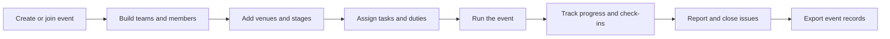
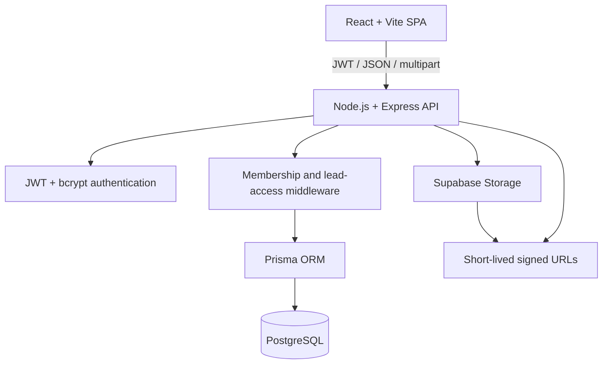
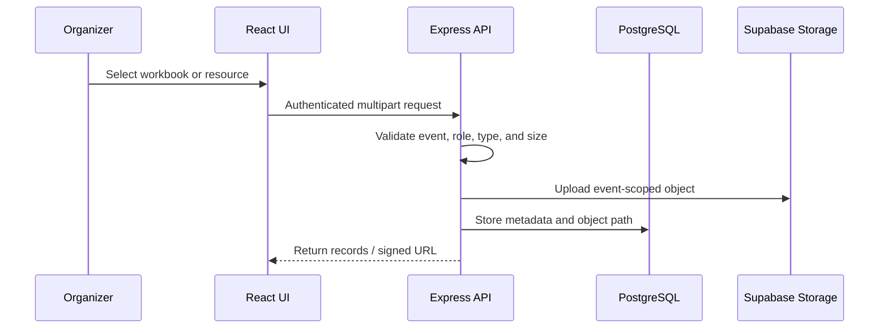

# Convene

<div align="center">

### The operating system for event day

**Plan the day · align the crew · keep the work moving**

</div>

> **One event. One shared picture.**
>
> Convene is an event command center that turns schedules, people, tasks, duties, resources, and event-day decisions into one coordinated workspace.

<div align="center">


</div>

<br />

<div align="center">

| 🗓️ **Schedule** | 👥 **People** | ✅ **Work** | 🚨 **Issues** | 📦 **Resources** |
|:---:|:---:|:---:|:---:|:---:|
| Run of Show | Teams & participants | Tasks & duties | Report & resolve | Private event files |

</div>

> Convene is designed for the moment when an event stops being a plan and becomes a moving system.

## Product at a glance

```text
                         CONVENE
                            │
             ┌──────────────┼──────────────┐
             │              │              │
        PLAN THE DAY   MOVE THE WORK   SEE THE WHOLE
             │              │              │
     Run of Show      Tasks + Duties   Mission Control
     Stages + Venues  Teams + Members  Progress + Issues
             └──────────────┼──────────────┘
                            │
                 One event-scoped workspace
```

Convene replaces the mixture of spreadsheets, chat threads, shared files, and last-minute messages used to coordinate live events. Every operational record belongs to an event, and every event view is filtered through authenticated membership.

## The workspace, visually

```text
┌──────────────────────────────────────────────────────────────────────┐
│  CONVENE  /  MISSION CONTROL                         LIVE EVENT       │
├───────────────┬──────────────────────────────────────────────────────┤
│  Dashboard    │  EVENT OVERVIEW                                      │
│  Participants │  ┌────────────┐ ┌────────────┐ ┌────────────┐        │
│  Tasks        │  │ 24 people  │ │ 16 tasks   │ │ 84% on time│        │
│  Duties       │  └────────────┘ └────────────┘ └────────────┘        │
│  Teams        │                                                      │
│  Run of Show  │  ──●────────●────────○────────○──  RUN OF SHOW       │
│               │    Opening   Sessions   Build      Finale             │
│  Inventory    │                                                      │
│  Resources    │  YOUR TASKS              YOUR DUTIES                  │
│  Issues       │  □ Stage setup           09:00–10:00  Registration    │
└───────────────┴──────────────────────────────────────────────────────┘
```

The interface is intentionally organized around three questions: **what is happening now, who owns the next action, and what changed?**

## What the product does

| Area | What users can do | Primary users |
|---|---|---|
| Mission Control | See current stage, progress, assigned work, and operational focus | Everyone in the event |
| Run of Show | Build stages with exact start/end timestamps, venues, status, and handoffs | Lead organizers |
| Teams | Create organizing teams, members, access levels, and invite keys | Lead organizers |
| Participants | Import, export, register, group by team code, check in, and verify QR codes | Organizers |
| Tasks | Assign preparation work, set status/priority/due date, and track completion | Organizers and assignees |
| Duties | Create event-day shifts, add notes/venues, assign people, and mark work complete | Organizers and assignees |
| Inventory | Maintain event equipment and operational stock | Lead organizers |
| Resources | Upload private PDF, image, CSV, XLS, and XLSX files up to 5 MB | Lead organizers |
| Issues | Report and close incidents with priority and resolution feedback | Event members |

## The core event loop



## Architecture



### Security boundary

The backend is the source of truth for authorization. Frontend role state only controls the experience; every protected API request checks the JWT, exact event membership, and—where required—lead organizer access.

```text
request
  └─ authenticate JWT
      └─ resolve event / target record
          └─ verify EventMembership
              └─ verify lead access when required
                  └─ validate input
                      └─ Prisma / Storage operation
```

## Screens and user journeys

```text
PUBLIC
Landing ──> Login / Register
                  │
                  ├── Create event ──> Onboarding ──> Dashboard
                  └── Join event ────> Event selection ─> Dashboard

ORGANIZER WORKSPACE
Dashboard ─┬─ Participants ─ Teams ─ Run of Show
           ├─ Tasks ─ Duties ─ Inventory
           ├─ Resources ─ Issues
           └─ Settings / theme preferences

PARTICIPANT EXPERIENCE
Event dashboard ──> schedule, venues, assigned work, QR/check-in context
```

## Visual system

Convene uses a shared token-based UI system rather than scattered page-specific color literals.

```text
┌────────────────────┬────────────────────┬────────────────────┐
│ Warm Copper        │ Forest Authority   │ Obsidian Copper    │
│ warm / editorial   │ grounded / green   │ dark / copper      │
├────────────────────┼────────────────────┼────────────────────┤
│ Plum Prestige      │ Nordic Marigold    │ Blue Daylight      │
│ violet / refined   │ warm / energetic   │ cool / familiar    │
└────────────────────┴────────────────────┴────────────────────┘
```

- Themes: `frontend/src/constants/conveneTheme.js`
- Shared colors: `frontend/src/constants/colors.js`
- Typography: `frontend/src/constants/typography.js`
- CSS variables: `frontend/src/styles/convene-theme.css`
- Theme choice is persisted locally as `convene_palette`.
- The favicon is fixed black; the in-app mark follows the selected palette.

## Import and storage flow



Supported resource files: `PDF`, `JPG`, `PNG`, `CSV`, `XLS`, and `XLSX`, maximum 5 MB per file.

Participant imports use one worksheet. A consistent `teamCode` groups people into the same participant team, so display-name variations do not split a team accidentally.

## Technology and libraries

### Frontend

| Library | Role |
|---|---|
| React 19 | Component-based interface |
| Vite | Development server and production bundling |
| React Router | SPA routing and protected routes |
| Zustand | Session, active-event, role, and theme state |
| Framer Motion | Page transitions and landing-page motion |
| Tailwind CSS | Utility styling |
| `clsx` + `tailwind-merge` | Conditional class composition |
| Lucide React | Icon system |
| React Hook Form + Zod | Form and validation utilities |
| Sonner | Toast notifications |

### Backend

| Library | Role |
|---|---|
| Express | HTTP API and routing |
| Prisma + `@prisma/client` | PostgreSQL access and migrations |
| `jsonwebtoken` | Session tokens |
| `bcryptjs` | Password hashing |
| `helmet` | HTTP security headers |
| `cors` | Frontend origin policy |
| `multer` | Multipart upload parsing |
| `@supabase/supabase-js` | Private object storage and signed URLs |
| `xlsx` / SheetJS | Excel and CSV import/export |

## Repository map

```text
Convene/
├── frontend/
│   ├── src/pages/              Product screens
│   ├── src/components/         Shared UI and layout
│   ├── src/constants/          Colors, typography, palettes
│   ├── src/styles/             Global, theme, landing, login styles
│   └── public/                 Browser assets and favicon
├── backend/
│   ├── src/routes/             Event-scoped API routes
│   ├── src/middlewares/        Authentication and authorization
│   ├── prisma/schema.prisma    Database source of truth
│   ├── prisma/migrations/      Database migrations
│   └── src/utils/workbook.js   Spreadsheet conversion helpers
├── docs/                       Detailed project documentation
├── outputs/                    Generated import samples and inspections
└── README.md                   This visual project handoff
```

## Local development

### Requirements

- Node.js 22 or newer
- npm
- PostgreSQL or Supabase
- Supabase Storage bucket named `event-resources` for resource uploads

### Install and configure

```bash
npm install
cp backend/.env.example backend/.env
npx prisma generate --schema backend/prisma/schema.prisma
npx prisma migrate deploy --schema backend/prisma/schema.prisma
```

Backend environment: `backend/.env`

```env
PORT
NODE_ENV
CLIENT_URL
DATABASE_URL
JWT_SECRET
JWT_EXPIRES_IN
BCRYPT_SALT_ROUNDS
SUPABASE_URL
SUPABASE_SERVICE_ROLE_KEY
SUPABASE_STORAGE_BUCKET
```

Frontend environment: `frontend/.env`

```env
VITE_API_URL
```

Start the workspaces in separate terminals:

```bash
npm run dev:backend
npm run dev:frontend
```

Open `http://localhost:5173`.

### Seed development data

```bash
npm run seed --workspace convene-backend
npm run seed:demo --workspace convene-backend
```

Only use seed scripts against a development database.

## Render deployment topology

```text
                         Git repository
                         /            \
                        /              \
       Render Static Site              Render Web Service
       frontend/dist                   backend/src/server.js
       CDN + React Router              Express + Prisma
              │                              │
              └──── VITE_API_URL ────────────┘
                                             │
                               PostgreSQL + Supabase Storage
```

### Frontend Static Site

- Root directory: `frontend`
- Build command: `npm install && npm run build`
- Publish directory: `dist`
- Variable: `VITE_API_URL`
- Rewrite: `/*` → `/index.html`

### Backend Web Service

- Root directory: `backend`
- Build command: `npm install && npx prisma generate`
- Start command: `node src/server.js`
- Variables: `NODE_ENV`, `CLIENT_URL`, `DATABASE_URL`, `JWT_SECRET`, and Supabase settings

Never put `DATABASE_URL`, `JWT_SECRET`, or `SUPABASE_SERVICE_ROLE_KEY` in the frontend. Only `VITE_` variables are compiled into browser code.

## Validation

```bash
npm run build
npm run lint
git diff --check
```

## Documentation index

- [Product scope](docs/01-scope.md)
- [Architecture](docs/02-architecture.md)
- [Database model](docs/03-database.md)
- [Permissions](docs/04-permissions.md)
- [Workflows](docs/05-workflows.md)
- [API contract](docs/06-api.md)
- [Local setup](docs/07-setup.md)
- [Deployment](docs/08-deployment.md)
- [Import/export](docs/09-import-export.md)
- [Themes and UI](docs/10-themes.md)
